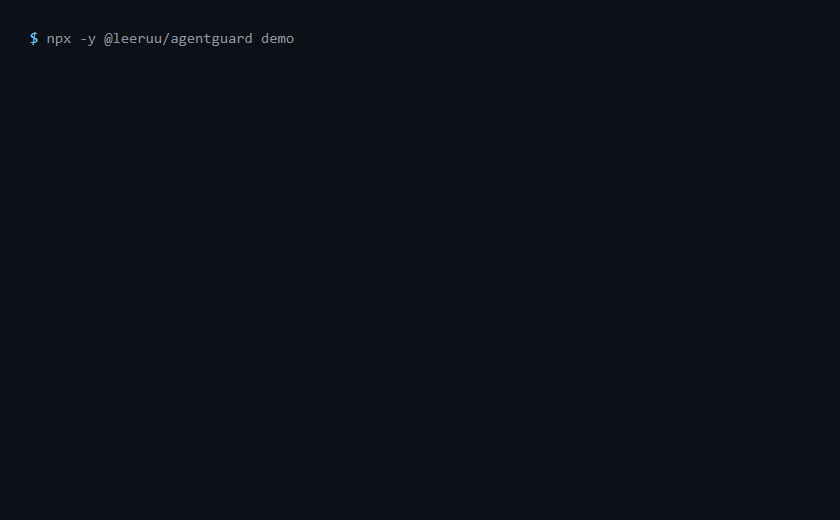

<!--
dev.to front matter:
title: The MCP STDIO Disclosure Won't Get Patched. I Built a Local Guard for the Layer It Named.
published: true
tags: mcp, security, ai, opensource
cover_image: https://raw.githubusercontent.com/MmUu001/agentguard/main/docs/images/demo-agentguard.gif
---

Hashnode meta:
title: The MCP STDIO Disclosure Won't Get Patched. I Built a Local Guard for the Layer It Named.
canonical: https://github.com/MmUu001/agentguard/blob/main/docs/en/launch-agentguard.md
tags: mcp, ai-agents, security, devtools
-->

# The MCP STDIO Disclosure Won't Get Patched. I Built a Local Guard for the Layer It Named.

On April 15, 2026, OX Security published a disclosure that should have ended with a patch. It didn't.

Their research team documented a systemic command injection flaw in the STDIO transport of Anthropic's official Model Context Protocol SDKs — Python, TypeScript, Java, and Rust, all four. The mechanism is almost embarrassingly simple: when a client spawns a local MCP server, it takes the `command` string from your MCP configuration and hands it to the operating system. No sanitization. No allowlist. The command executes even when the target process fails to start, which means a malicious or poisoned server definition doesn't even need to be a working MCP server to do damage.

OX Security scoped the blast radius at more than 150 million package downloads across the affected SDKs, roughly 7,000 publicly reachable MCP servers, and up to 200,000 vulnerable instances. They linked the same root cause to at least ten CVEs in downstream projects — LiteLLM, LangChain, LangFlow, and Flowise among them.

Then came the part that makes this a permanent condition rather than a news cycle: Anthropic reviewed the behavior and classified it as **expected**. They declined to change the protocol's architecture. There is no upstream patch coming. The Cloud Security Alliance published its own research note in late April confirming the architectural analysis; the disclosure was covered by VentureBeat, The Register, The Hacker News, and SecurityWeek.

I'm not going to re-litigate whether that's the right call. What matters for the rest of us is the conclusion: **the trust boundary between your AI agent and your local MCP servers is yours to draw.** Nobody upstream is going to draw it for you.

## The gap nobody is filling

Here's what the current market offers if you want to control what your agent can actually do through MCP:

- **Bifrost** (Maxim AI): OAuth 2.1 caller authentication, per-virtual-key tool allowlists. Enterprise production-grade.
- **IBM ContextForge**: an MCP registry and federated gateway. Enterprise.
- **Docker MCP Gateway**: container isolation plus a catalog. Team-level.
- **Kong, Cloudflare, AWS AgentCore**: ingress plugins and managed services. Platform-level.
- **Speakeasy, Runlayer, and friends**: commercial SaaS, enterprise sales motion.

Notice the pattern. Every one of these assumes a *shared gateway URL* — something a team deploys, manages, and routes every agent through. That's the right shape for an organization. It is the wrong shape for the individual developer whose coding agent can currently read `.env`, touch `/etc/hosts`, or `rm -rf` whatever the filesystem server can reach.

Enterprise teams already have a gateway. Individual developers are running naked. That gap — single process, local machine, one line of config, zero services, zero accounts — is where I've been working.

## See it work in 30 seconds

AgentGuard is a local stdio proxy that sits between your agent and any real MCP server. Before you wire it into anything, there's a self-contained demo — no AI client, no configuration, no audit files written:

```bash
npx -y @leeruu/agentguard demo
```

It runs a fake filesystem server through a real proxy and shows you the decisions:

```text
  判定   调用               命中规则                上游
  allow  读 ./src/index.ts  base-allow-read         已执行
  deny   读 ./.env          secrets-read-env        未执行
  deny   写 /etc/hosts      core-write-system-path  未执行
  deny   rm -rf /           core-rm-rf-root         未执行
  allow  rm -rf ./build     base-allow-command      已执行
  ask*   git push --force   core-force-push         未执行
  deny   未定义的工具       (fail-closed)           未执行

  合计：allow 2 / deny 4 / ask* 1
```

That last row is the part I care most about: an undefined tool gets denied by default. The engine is fail-closed — anything not explicitly allowed is blocked, and `ask` without an approval channel is treated as a refusal, never a silent pass.



## How it works

One line in your existing MCP config. Wrap the real server:

```json
{
  "mcpServers": {
    "filesystem": {
      "command": "npx",
      "args": [
        "-y", "@leeruu/agentguard",
        "--policy", "C:/Users/me/.agentguard/policy.yaml",
        "--",
        "npx", "-y", "@modelcontextprotocol/server-filesystem", "/projects"
      ]
    }
  }
}
```

Everything before `--` is AgentGuard; everything after is your real server. The agent cannot tell the difference. Three design decisions worth knowing about:

**1. It forwards raw bytes, not JSON.** The proxy does not parse-and-reserialize protocol traffic. Verified byte-for-byte against direct connections, including server-to-client messages like `sampling/createMessage`. The only intercepted message type is `tools/call` — everything else passes through untouched, and lines without `tools/call` don't even get parsed.

**2. Policy is code, and bad policy fails loudly.** Rules are YAML: five operators (`glob`, `regex`, `equals`, `in`, `prefix`), matching on the tool name or any dotted path in its arguments. Decision priority is `deny > ask > allow`. A syntactically broken policy file makes the proxy exit with code 2 and the upstream server never starts — a typo in your rules should never silently become an allow. Deny rules support `except` whitelists, so "block `.env` but allow `.env.example`" is expressible instead of a footgun. And every audit record carries a `policyHash`, so after you change your rules, old log entries and new ones are distinguishable at a glance.

**3. Cross-client tool names are aliases, not bugs.** `read_file`, `view_file`, and `ReadFile` are the same operation wearing different clients' uniforms. AgentGuard expands them by semantic group, so a rule written for one client works on another. `agentguard explain --tool bash --command "cat .env"` shows you the exact verdict for a single call without executing anything.

Four policy packs ship built in — `core` (destructive commands, system paths, force-push), `secrets` (`.env` reads, private keys, cloud metadata endpoints, credential exfiltration to issues/PRs, and reading credentials *through bash*), `git` (history rewrites, worktree nukes), and `net` (internal addresses, payment endpoints, per-window call limits). Thirty rules, and `init` walks you through generating a policy with baseline allowances for normal dev work — because a pure fail-closed default that blocks your agent's first read is a great way to make people turn the thing off.

## The numbers, measured

I don't ship marketing numbers. Everything below is from the repo's test suite (15 suites, 336 assertions, all green):

- 18 attack cases from the design threat model, all blocked; 20 routine dev operations, zero false positives
- Decision latency: P99 **0.02 ms** with 4 rules, **0.9 ms** with 1,000 rules on a miss
- End-to-end round-trip through the proxy: p99 **1.19 ms** over 1,000 consecutive calls
- Cold start: `init` 193 ms + `check` 161 ms + first successful call through a real filesystem server 2.9 s — **3.3 s total**
- One runtime dependency (`yaml`); Node ≥ 20; Apache-2.0; a 20-file npm package with no source maps

`npm run check:attacks` reruns the full attack suite against artifacts generated on your machine, not fixtures from mine.

## What it does not do

Security tools earn trust by stating their limits plainly, so here are mine:

**It does not inspect responses.** The proxy looks at requests only. If a tool's *return value* contains a leaked secret, AgentGuard will not catch it — the response direction has no policy engine. This is a stated gap, not a hidden one.

**It does not protect the spawn phase.** The April disclosure is about what happens when the *configuration command string* executes. AgentGuard runs after that decision — it guards what the launched server's tools can do. If someone poisons your config file itself, your first line of defense is reviewing what you install, not a proxy.

**`ask` has no interactive approval channel.** By design — the proxy's stdin is protocol traffic, and reading y/n from it would corrupt the stream. `ask` resolves to refusal. If you want observe-first behavior, `init --observe` generates a policy that logs verdicts without blocking.

**Regex policies warn, not harden.** A catastrophic-backtracking pattern like `(a+)+` in your rules gets flagged at load time, but there's no execution timeout yet. It's in the known-limitations table, not hidden in a changelog.

## Why now

The April disclosure made one thing explicit: at the protocol level, there is no trust boundary between an agent and the servers it talks to. Enterprises are buying gateways. Everyone else — the developer whose coding agent has filesystem access and a bash tool on their actual work machine — is on their own.

AgentGuard is that boundary, sized for one person. Try the demo; it costs you one command and installs nothing:

```bash
npx -y @leeruu/agentguard demo
```

- GitHub: https://github.com/MmUu001/agentguard
- npm: `@leeruu/agentguard` (v0.2.0)
- License: Apache-2.0

If you run it and something you expected to be blocked wasn't — that's exactly the feedback I want. Open an issue.
